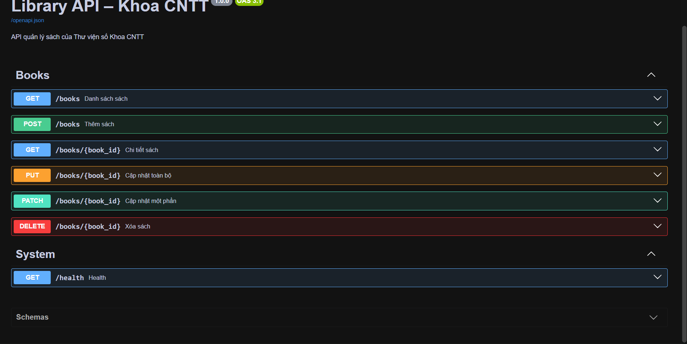

# Lab 4 – Library API (FastAPI)

Ứng dụng RESTful API quản lý sách của Thư viện số Khoa CNTT, thực hiện bằng FastAPI và Pydantic. Dữ liệu mẫu được lưu trong bộ nhớ (RAM), không dùng cơ sở dữ liệu, nên trở lại mặc định khi khởi động lại máy chủ.

## 1. Yêu cầu môi trường

- Ubuntu/WSL2, Python 3.10 trở lên, Git.
- Postman Desktop để chạy bộ kiểm thử.

## 2. Cài đặt và chạy

Từ **thư mục gốc của repository** (thư mục chứa `app/` và `requirements.txt`), chạy:

```bash
python3 -m venv .venv
source .venv/bin/activate
python -m pip install -r requirements.txt
python -m uvicorn app.main:app --host 0.0.0.0 --port 8000 --reload
```

Truy cập Swagger UI: http://127.0.0.1:8000/docs

## 3. Danh sách endpoint

| Phương thức | Đường dẫn | Chức năng | HTTP thành công |
| --- | --- | --- | --- |
| GET | `/health` | Kiểm tra trạng thái máy chủ | 200 |
| GET | `/books` | Danh sách, lọc `q`, `author`, phân trang `skip`, `limit` | 200 |
| GET | `/books/{book_id}` | Xem chi tiết sách | 200 |
| POST | `/books` | Thêm sách mới, kiểm tra ISBN duy nhất | 201 |
| PUT | `/books/{book_id}` | Cập nhật toàn bộ thông tin sách | 200 |
| PATCH | `/books/{book_id}` | Cập nhật một phần thông tin sách | 200 |
| DELETE | `/books/{book_id}` | Xóa sách | 204 |

Các mã lỗi được kiểm thử: **404** (không tìm thấy), **409** (ISBN trùng), **422** (dữ liệu không hợp lệ).

## 4. Kiểm thử Postman

1. Mở Postman, import `postman/Library-API.postman_collection.json` và `postman/Library-Local.postman_environment.json`.
2. Chọn environment `Library-Local` với `baseUrl` là `http://localhost:8000`.
3. Giữ server FastAPI đang chạy. Mở Collection Runner, chạy theo đúng thứ tự **TC01–TC12**, iterations = **1**.
4. Kiểm tra toàn bộ assertion Passed. Chụp ảnh kết quả vào `docs/postman_runner.png`.

**Lưu ý:** Nếu đã thử thêm sách trước đó, hoặc muốn chạy lại Runner, hãy dừng server bằng Ctrl+C rồi khởi động lại để xóa dữ liệu thêm trong RAM.

## 5. Minh chứng

Swagger UI:



Postman Collection Runner:


## 6. GitHub và nộp bài

Làm việc trên nhánh `feature/books-api`, push cả `main` và `feature/books-api`, tạo Pull Request **base: main** ← **compare: feature/books-api**. Nộp đường link Pull Request trên LMS.
